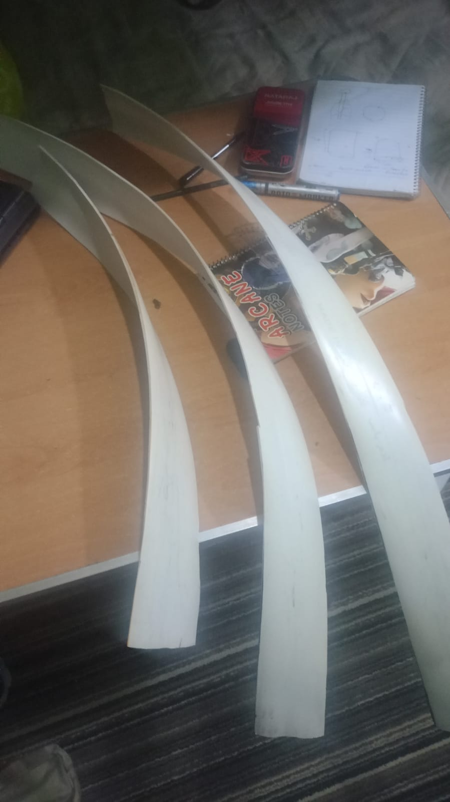
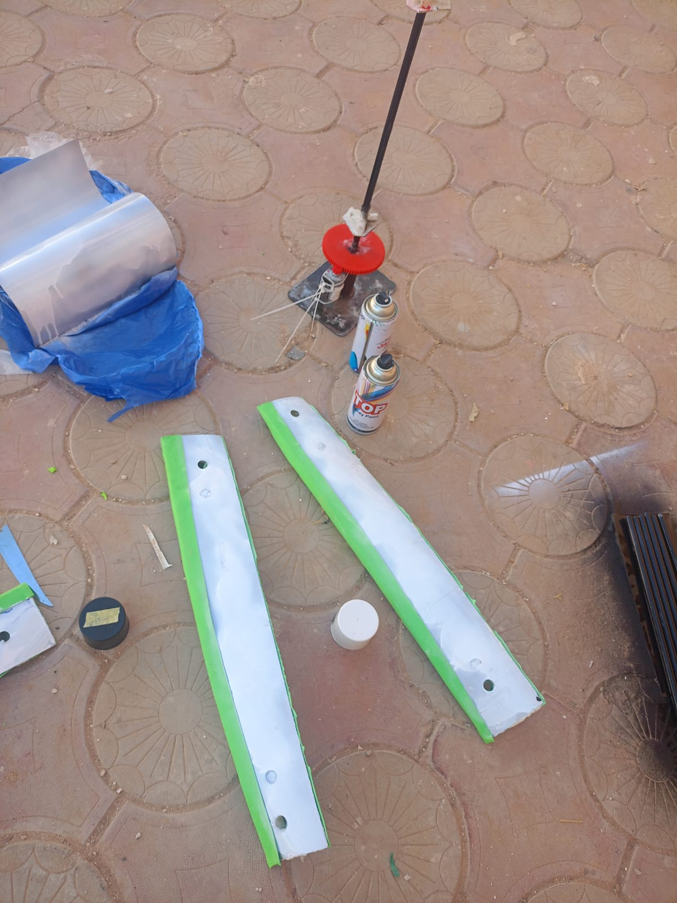
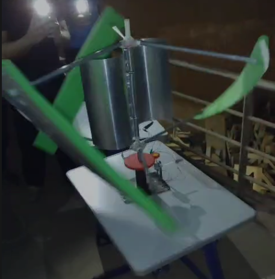

# Hybrid vertical axis wind turbine

This is a hybrid VAWT I built using helical blades and a Savonius section. The design, simulations, and materials were already prepared before the build journal starts. The hands-on work took five days, about 28.5 hours in total.

## The build

I started by cutting UPVC pipe into three blades and heating them into a helical shape. They came out too heavy, so I used them as templates for thinner aluminum blades instead.

The Savonius section uses two curved aluminum blades. I mounted the blades on an aluminum shaft and frame, then assembled the bearings, printed gears, and dynamo. Getting the bearings aligned took a while, and the first higher-speed tests had vibration that I reduced by tightening the joints and adjusting the blade spacing.

The journal records the assembly and testing, but doesn't include a measured power curve or efficiency result.

## Photos and videos

- [Build video](Video.mp4)
- [Simulation video](simulation.mp4)
- [Full build journal](JOURNAL.md)
- [More photos](Images/)

This repo is mainly a record of the physical build. The original CAD and simulation source files haven't been uploaded here.
